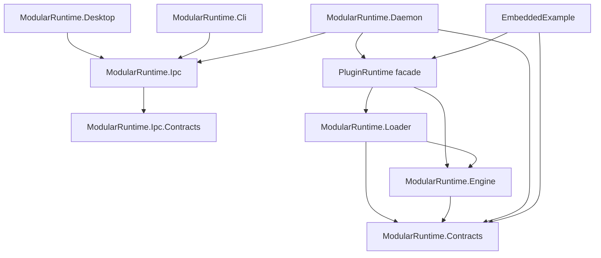

# Architecture

## Goals

ModularRuntime separates plugin contracts, lifecycle management, physical
loading, and host presentation, and (since v0.2) provides an in-process
extensibility platform shared by plugins and hosts. The implementation is designed
around these constraints:

- the engine must not know how assemblies are loaded;
- the loader must use one collectible load context per plugin;
- plugin contracts must keep one runtime-wide identity;
- lifecycle operations must be concurrency-safe and failure-isolated;
- the daemon and embedded applications must share the same composition code;
- since v0.3, the runtime lives in one background process per user profile
  (the daemon) and user interfaces are separate IPC clients whose lifetime never
  affects the runtime;
- plugin deployments must be directory-based and validated before loading;
- plugins communicate only through runtime-mediated, neutral contracts (events,
  services, extension points) and never reference each other's assemblies;
- every resource is owned by exactly one host or plugin instance and is released
  automatically, so a stopped plugin's load context can be collected.

Non-goals are described in [ROADMAP.md](ROADMAP.md). The platform itself is
documented in detail in [V0.2_EXTENSIBILITY.md](V0.2_EXTENSIBILITY.md); the
process split in [V0.3_DESKTOP.md](V0.3_DESKTOP.md),
[IPC_PROTOCOL.md](IPC_PROTOCOL.md), and [PROCESS_LIFECYCLE.md](PROCESS_LIFECYCLE.md).

## Component graph



`ModularRuntime.Desktop` and `ModularRuntime.Cli` reference only the IPC
libraries: they cannot load plugins or touch runtime objects, by construction.
At run time there are three processes; only the daemon hosts the engine:

```text
Desktop / CLI ── named pipe, IPC protocol v1 ── Daemon ── PluginRuntime ── plugins
```

Inside the engine:

```text
PluginEngine (one per runtime, RuntimeId)
 ├─ lifecycle: PluginSlot per plugin (gate, state, instance, lifetime token)
 ├─ RuntimeCore
 │   ├─ EventBus          copy-on-write subscriptions per topic
 │   ├─ ServiceRegistry   one provider per service ID
 │   └─ ExtensionRegistry points + contributions
 ├─ OwnershipScope per plugin instance + one host scope
 │   (resources, in-flight invocation counter, cancellation, drain)
 └─ RuntimeScopeFacade: IRuntimeScope / IPluginContext bound to one scope
```

| Project | Responsibility | Must not depend on |
| --- | --- | --- |
| `ModularRuntime.Contracts` | Public SDK: lifecycle, context, events, services, extensions, ownership, payloads, results, logging | Engine, Loader, IPC |
| `ModularRuntime.Engine` | Registration, lifecycle, event bus, service and extension registries, resource ownership, concurrency, cancellation, failure isolation, state version | Loader, `AssemblyLoadContext`, IPC |
| `ModularRuntime.Loader` | Discovery, manifest validation, collectible loading, composition facade | IPC, Daemon |
| `ModularRuntime.Ipc.Contracts` | Protocol v1: envelope, operation and notification names, error codes, DTOs | Everything (no references) |
| `ModularRuntime.Ipc` | Framing, pipe security, server, client, typed `RuntimeClient`, profiles, daemon launcher | Engine, Loader, Contracts |
| `ModularRuntime.Daemon` | Process that owns `PluginRuntime`; maps IPC operations to runtime APIs; log store; single instance; shutdown | WPF, clients |
| `ModularRuntime.Cli` | Command-line IPC client | Engine, Loader, Contracts |
| `ModularRuntime.Desktop` | WPF IPC client (MVVM) | Engine, Loader, Contracts |
| `EmbeddedExample` | In-process composition demonstration | IPC |

The engine exposes `IPluginInstanceFactory`, which has only `CreateAsync` and
`ReleaseAsync`. The loader implements it with `AssemblyPluginInstanceFactory`.
This is the boundary that keeps loading details out of the engine.

## Contracts

The contracts assembly is the whole plugin SDK, in one namespace
(`ModularRuntime.Contracts`) organized in folders:

- lifecycle: `IPlugin`, `IPluginContext`, `PluginId`, `PluginDescriptor`
  (including `StartOrder`), `PluginState`, `PluginApiVersion`;
- scope: `IRuntimeScope` (owner, events, services, extensions, resources) — the
  plugin context extends it, and hosts get one from `PluginRuntime.Host`;
- `Events/`, `Services/`, `Extensions/`, `Ownership/`, `Invocation/` — see
  [V0.2_EXTENSIBILITY.md](V0.2_EXTENSIBILITY.md#public-api-overview);
- results and errors: `PluginOperationResult`, `PluginOperationStatus`,
  `PluginErrorCodes`, `PluginRuntimeException` (with `ErrorCode`),
  `PluginDiagnostic` (text-only exception snapshot);
- logging: `IPluginLogger`, `IRuntimeLogger`, `LogEntry`.

Only neutral data crosses plugin boundaries: `JsonPayload` (validated immutable
JSON text), strings, numbers, GUIDs, `Version`, and records defined here.

The product version is `0.6.0`. The plugin API is experimental, version `0.3`,
and `ModularRuntime.Contracts` has `AssemblyVersion` `0.3.0.0` (see [VERSIONING.md](VERSIONING.md)).
API 0.3 added `IPluginContext.Descriptor`. For a 0.x API a
plugin must declare exactly the supported major.minor and be compiled against
contracts with the same major.minor; any 0.x minor may break. From API 1.0 the
rule becomes "same major, minor less than or equal to the supported minor", with
a fixed contracts assembly version per major line.

## Engine

`PluginEngine` owns a registry of `PluginSlot` objects. Each slot contains:

- the immutable descriptor;
- one single-use `IPluginInstanceFactory`;
- a `SemaphoreSlim` gate that serializes start/stop work for that plugin;
- the current state, timestamps, instance ID, and last error;
- a lifetime token source while an instance is attached.

Registration is protected by a registry lock and preserves registration order.
`GetPlugins` returns a snapshot; callers cannot mutate engine state through the
returned list. Start and stop operations await the per-plugin gate and re-check
state after acquiring it, so concurrent callers cannot both perform the same
transition.

Each started instance also gets an `OwnershipScope` and a context
(`EnginePluginContext`) whose `Events`, `Services`, `Extensions`, and `Resources`
are facades bound to that scope. The engine owns one host scope, exposed as
`PluginEngine.Host`, released last during disposal.

Important engine properties:

- **Automatic cleanup.** Stop, failed start, and disposal close the instance's
  scope, cancel and drain its in-flight handlers, run `ShutdownAsync`, release
  every resource it owns, detach the instance, and only then release the factory.
  See [LIFECYCLE.md](LIFECYCLE.md#teardown-order).
- **Runtime isolation.** Every engine has its own `RuntimeId`, registries, and
  scopes; there is no static or process-wide registry.
- **No plugin references after shutdown.** A started instance is detached before
  the factory is released. Results (`PluginOperationResult`), retained errors
  (`PluginRuntimeInfo.LastError` / `PluginErrorInfo`), log entries, and load
  errors store only `PluginDiagnostic` text, never exception objects. Exception
  objects from plugins can keep the plugin's collectible load context alive
  (through the exception type and through stack-trace keep-alive data), so the
  engine converts them to text immediately and drops the reference before any
  further await.
- **Defensive diagnostics.** Capturing a diagnostic never throws, even when a
  plugin exception overrides `Message`, `StackTrace`, or `ToString` with code
  that throws.
- **Best-effort logging.** Host logger failures are caught by the engine and
  loader and never interrupt a lifecycle transition or reach plugin code.
- **Terminal states.** `Stopped` and `Failed` have no outgoing transitions.
  Restarting requires a new registration and a new factory; `PluginRuntime`
  creates both (after re-reading and re-verifying the installation) when a stopped
  or failed plugin is started or restarted. See [LIFECYCLE.md](LIFECYCLE.md#restart).
- **Failure isolation.** An exception from one plugin is converted into a
  `PluginOperationResult` or a retained error and does not unwind the engine.
- **Ordered bulk operations.** `StartAllAsync` visits plugins in registration
  order. `StopAllAsync` and disposal visit them in reverse registration order.
- **Idempotent disposal.** `DisposeAsync` starts one shutdown task and awaits it
  on subsequent calls.
- **Single-use factories.** A factory that has been released cannot create a new
  instance.

`PluginLifecycle` contains the formal transition table. See
[LIFECYCLE.md](LIFECYCLE.md).

## Loader

### Discovery and validation

Discovery scans only immediate subdirectories of the configured plugin root that
contain a `plugin.json` file. Nested plugin installations are not scanned.
Directories are sorted with an ordinal-ignore-case comparer before processing,
which makes duplicate-ID behavior deterministic: the first valid manifest wins
and later manifests with the same ID produce a discovery error.

The manifest reader is deliberately strict:

- maximum manifest size of 256 KiB;
- case-sensitive JSON property names;
- unknown properties are rejected;
- every required field is validated;
- plugins and versions use explicit numeric formats;
- the entry assembly path must be relative, end in `.dll`, and remain inside the
  installation directory;
- the entry assembly must exist;
- API compatibility is checked before a candidate is created.

Discovery failures are collected as `PluginDiscoveryError` values. They do not
throw for malformed individual plugins. Registration failures produced while
composing the runtime are returned by `PluginRuntimeDiscoveryResult`.

### Load contexts

Each plugin gets one private `PluginLoadContext`:

- named `ModularRuntime.Plugin.<pluginId>.<guid>`;
- collectible;
- backed by `AssemblyDependencyResolver` using the entry assembly path, so
  managed and unmanaged dependencies declared by the plugin's `.deps.json` can
  resolve from the plugin directory;
- configured to always return the runtime's `ModularRuntime.Contracts` assembly
  for contract requests.

The loader also verifies that the entry assembly references the shared contracts
assembly and that its referenced major version matches. This prevents a private
contracts copy from becoming a second `IPlugin` identity.

`AssemblyPluginInstanceFactory`:

- validates the descriptor against the discovered candidate;
- loads the entry assembly with `LoadFromAssemblyPath`;
- finds the exact public entry type;
- requires it to implement `IPlugin`, be concrete, non-generic, and expose a
  public parameterless constructor;
- creates exactly one instance;
- releases the load context idempotently.

Unload is cooperative. The runtime requests unload when the factory is released,
but collection only happens after no strong references remain, including
references held by the plugin itself.

## Composition facade

`PluginRuntime` composes `PluginLoader` and `PluginEngine`. `DiscoverAsync`:

1. asks the loader to scan and validate the root;
2. creates one factory per valid candidate;
3. registers the descriptor with the engine;
4. marks the plugin validated;
5. releases the factory if registration or validation fails;
6. returns discovery errors, registration failures, and the registered count.

Host and embedded applications use this facade rather than duplicating
discovery or lifecycle logic. Independent `PluginRuntime` instances are
isolated: they have separate registries and separate load contexts even when
they point at the same plugin root.

## Daemon and clients (v0.3)

The interactive console host of v0.1–v0.2 (`ModularRuntime.Host`) was replaced
by three executables.

**Daemon** (`ModularRuntime.Daemon`, GUI subsystem, no window):

- `DaemonEntryPoint` parses options, takes the per-profile single-instance
  mutex, registers termination signals, and maps the outcome to an exit code;
- `DaemonHost` owns the `PluginRuntime`, the `IpcServer`, the state notifier,
  and the ordered shutdown;
- `DaemonRequestHandler` maps each protocol operation to a public runtime API
  (snapshots, lifecycle, catalogs, logs) and validates every payload; it contains
  no lifecycle logic of its own;
- `LogStore` is the runtime's `IRuntimeLogger`: a bounded ring buffer with
  sequence numbers, per-subscription bounded queues with drop counting, and a
  daily log file written by a background task.

**State versioning.** The engine increments a `StateVersion` whenever plugin
state, registrations, or ownership change (`RuntimeCore.NotifyStateChanged`,
invoked outside locks), and exposes `WaitForStateChangeAsync(knownVersion)`.
The daemon's notifier waits on it, coalesces changes (100 ms), and sends
`state.changed` to subscribed clients, which then load fresh snapshots. The
engine never calls into IPC code; the daemon pulls.

**IPC** (`ModularRuntime.Ipc`): length-prefixed JSON over a per-user,
per-profile named pipe; see [IPC_PROTOCOL.md](IPC_PROTOCOL.md). Each connection
has one read loop, one task per request (bounded), and a bounded notification
queue pumped by its own task, so a slow client cannot stall the daemon or other
clients.

**CLI** (`ModularRuntime.Cli`): one connection per command, human or `--json`
output, coherent exit codes; `logs --follow` merges history and stream by
sequence.

**Desktop** (`ModularRuntime.Desktop`, WPF, MVVM without third-party packages):

- `RuntimeConnection` supervises the single connection (connect, optional
  automatic daemon start, state subscription, loss detection, reconnection with
  bounded backoff) on a background task and raises events;
- view models receive those events through `IUiDispatcher` and only then touch
  bindable state; pages refresh snapshots on `state.changed`, coalescing
  refreshes, and clear their data while disconnected;
- lifecycle commands never update state optimistically: the item shows a busy
  indicator and the list is refreshed from the daemon after the reply;
- the logs page queues streamed entries off the UI thread and drains them on a
  150 ms UI timer, bounded to 5000 entries;
- services (`IRuntimeClientFactory`, `IDaemonController`, `IDialogService`,
  `IUiDispatcher`) are interfaces so view models are tested without a daemon or a
  window.

See [PROCESS_LIFECYCLE.md](PROCESS_LIFECYCLE.md) for how the processes start,
stop, and survive each other.

## Plugin manager (v0.4)

Two libraries without UI dependencies, composed by the daemon:

- **`ModularRuntime.Packaging`** — `PackageArchive` (ZIP inspection with path, type, collision,
  and size rules; extraction with real limits), `IntegrityManifest` (strict parse, deterministic
  serialize), `SignatureEnvelope` and `TrustStore` (ECDSA P-256, key IDs, purposes, revocation,
  test-key separation), `PackageVerifier` (the full verification sequence), `PackageBuilder`
  (manifest and deterministic ZIP for the publisher), `PackageStore` (staging under
  `plugins/.staging`, journaled atomic publish/remove, records, crash recovery, verification
  with file locking), and `PackageLoadVerifier` (the Loader gate).
- **`ModularRuntime.Registry`** — `RegistryDocument` (strict schema), `RegistryClient`
  (download, signature, freshness, rollback state, cache), `DefaultRegistryTransport` (https
  and file mirrors, size-limited).

Changes to existing components:

- **Loader**: `IPluginLoadVerifier` is called by `AssemblyPluginInstanceFactory` immediately
  before every load; a returned lease (open file handles) is kept until the factory is released.
  `PluginRuntime` gained `RegisterInstallationAsync`, `UnregisterAsync`, `WaitForUnloadAsync`,
  and `GetInstallation(s)`; `PluginLoader.ReadInstallationAsync` validates one directory.
- **Engine**: `PluginEngine.UnregisterAsync` removes inactive plugins under the plugin's gate;
  lifecycle calls that captured a removed slot see `plugin_not_found`.
- **Daemon**: `PackageManager` maps the `registry.*` and `packages.*` IPC operations onto these
  libraries, runs long operations in the background with progress notifications, owns uploads,
  enforces one operation per plugin, and applies the auto-start policy.
- **Clients**: the desktop app (Store, Plugins, preview dialog) and the CLI only call
  IPC operations; neither references Packaging or Registry.

The administrator's signing tools (a separate, private repository that depends on this one) use
the same libraries, so the format written by the administrator and the format verified by the
daemon come from one implementation.

## Developer SDK (v0.5)

```text
ModularRuntime.Sdk ──▶ Contracts              (private to each plugin; helpers only, no engine)
ModularRuntime.Templates                      (dotnet new content; no code dependencies)
ModularRuntime.DevTools ──▶ Packaging ──▶ Loader ──▶ Engine ──▶ Contracts
                        ──▶ Registry (catalog verification), Submissions (submission format)
                                                  (no Daemon, Ipc, Desktop, no signing)
```

- **Sdk** adds typed JSON payloads (`PluginJson`), `PluginOperations` (an operation router that
  produces the existing `PluginInvocationHandler`), typed `InvokeAsync` for services and
  extensions, and `RunInBackground`. It is a library of extension methods over the contracts,
  not a second engine or a second extension mechanism. Plugins ship it privately.
- **DevTools** (`dotnet modularruntime`) reuses the Loader's manifest rules
  (`PluginLoader.ValidateManifestAsync`, `ReadInstallationAsync`), the Packaging path rules,
  `PackageBuilder`, and `PackageVerifier`. It reads assemblies with `System.Reflection.Metadata`
  (never loading them) and builds through `dotnet build`. It has no signing capability; official
  signing is done offline by the administrator's private tools.
- **Packages:** Contracts, Sdk, Engine, Loader (embedding), Templates, and DevTools are packable
  (`scripts/pack-sdk.ps1`). Every other project sets `IsPackable=false` through `Directory.Build.props`.

## Official publishing (v0.6)

```text
ModularRuntime.Submissions                         (submission.json / source-integrity.json format, secret classifier)
ModularRuntime.DevTools   ──▶ Submissions           (prepare-submission)
ModularRuntime.Registry   ──▶ RegistryCatalogCheck  (public catalog rules: signature, validity, rollback, immutability, revocations)
ModularRuntime.Daemon     ──▶ RevocationGate ──▶ PackageLoadVerifier (revocations from the signed catalog, then integrity)
```

- Review, controlled builds, approvals, and signing are done by the administrator's tools, kept in
  a separate private repository that depends on this one (never the other way round). They add
  records and gates around the public formats; they do not add a package format, verifier, or
  catalog. Approvals use the existing signature envelope and trust store with a third key purpose
  (`approvals`) that the daemon never uses.
- `RegistryDocument` schema 2 carries version status and revoked keys. The daemon's package
  manager keeps the last verified catalog as the revocation source (also when it has expired),
  and the load gate refuses revoked installations before the integrity check.
- The public registry repository (catalog, packages, schemas, public trust store, read-only
  validation workflow) is separate; its CI verifies with `dotnet modularruntime registry-check`.
  See [REPOSITORY_ORGANIZATION.md](REPOSITORY_ORGANIZATION.md).

## Concurrency model

- Lifecycle mutations for one plugin are serialized by that plugin's gate.
- Locks are private and local: engine registry, each plugin slot, each ownership
  scope, the event bus, the service registry, and the extension registry. There
  is no global lock, and **no lock is ever held while another is acquired**, so
  lock inversion is impossible. Owner state is read outside registry locks.
- **No owner code runs under a runtime lock**: event handlers, service and
  contribution handlers, cancellation callbacks, tracked disposables, and host
  loggers are always invoked after locks are released. Publication dispatches a
  snapshot (copy-on-write arrays); registries copy entries before building
  descriptors.
- Every invocation of a handler is admitted through its owner's scope (an
  in-flight counter that rejects new work once the owner is closing) and the
  registration's release flag is re-checked after admission. This defines when a
  removal takes effect and lets teardown drain exactly the started invocations.
- Reentrancy: the engine records, per asynchronous flow, which owners' code is
  running (GUID-only frames). Stopping a plugin from its own flow returns
  `reentrant_lifecycle_operation`; disposing the runtime from inside any of its
  callbacks throws with the same code. Nested publications are bounded by
  `RuntimeLimits.MaxEventDispatchDepth`.
- Logging is an external abstraction; logger exceptions are swallowed so they
  cannot leave a slot in a transitional state.
- `CancellationTokenSource.Cancel()` is never called while a slot or scope lock
  is held. Token sources are disposed exactly once, never while a callback or an
  in-flight invocation can still use them; a scope close waits for cancellation
  callbacks started on another thread before releasing resources (v0.2.1).
- Releasing an owned resource is one shared operation (v0.2.1): every caller awaits
  the same completion, and a resource leaves its scope only when its release has
  finished, so teardown never requests unload while cleanup is pending.
- Cancellation is cooperative. Pre-operation cancellation is reported as
  `Canceled` without changing state. Cancellation observed during a start or
  stop operation moves the instance to `Failed` and releases resources.
- Disposal sets a shutdown flag, cancels instances that are still initializing,
  stops plugins in reverse start order, releases factories, and finally closes
  the host scope.
- After plugin code completes asynchronously, the runtime resumes on a fresh
  thread-pool stack (`ThreadPoolHop`) before returning to callers, so caller
  continuations never run on top of plugin frames.

## Testing strategy

- `Engine.Tests` use fake factories and plugins to test registration,
  transitions, concurrency, cancellation, and shutdown without file I/O.
- `Loader.Tests` stage real assemblies, test discovery and manifest rejection,
  verify private dependency resolution, contracts identity, and cooperative
  unload.
- `Integration.Tests` compose the real loader, engine, and facade with the
  sample plugins. They cover start/stop, failure isolation, independent runtime
  instances, and load-context collection after disposal.
- v0.2 adds `EventBusTests`, `ServiceRegistryTests`, `ExtensionRegistryTests`,
  and `ResourceOwnershipTests` (engine level, including concurrency, reentrancy,
  drain, and lock-discipline tests), `PlatformUnloadTests` (real load contexts:
  handler release, retained service handles, retained contribution snapshots,
  failed initialization, in-flight handlers, retained results, and a negative
  control), and `PlatformSamplesIntegrationTests` (all samples end to end and
  runtime isolation).
- v0.1.1 added reliability suites: slot cancellation and reentrancy
  (`PluginSlotCancellationTests`), engine cancellation, failing loggers, hostile
  exceptions, disposal during initialization, and a start/stop/dispose stress
  test (`PluginEngineCancellationTests`, `PluginEngineReliabilityTests`), and
  `WeakReference`-based unload tests that retain every result, info snapshot,
  and log entry while requiring the load context to be collected
  (`PluginExceptionUnloadTests`, `PluginReliabilityUnloadTests`).

All file-based tests use isolated temporary directories. Build targets copy
plugin outputs into the test output directory; tests copy those assets into
their own workspace.

## Design decisions and trade-offs

| Decision | Reason | Trade-off |
| --- | --- | --- |
| Separate contracts assembly | Stable identity across plugin contexts | Breaking changes require coordinated versioning |
| Engine/factory boundary | Keeps ALC details out of lifecycle code | One more abstraction to implement |
| Collectible ALC per plugin | Dependency isolation and cooperative unload | Collection is not deterministic |
| Strict manifest | Early, actionable validation | No forward-compatible unknown fields |
| Terminal stopped/failed states | Avoid accidental reuse of dirty instances | Restart needs a new registration (done by `PluginRuntime`) |
| `PluginRuntime` facade | One composition used by host and embedders | Hides lower-level composition from simple consumers |
| Text-only diagnostics everywhere (`PluginDiagnostic`) | Avoid keeping plugin exceptions and load contexts alive | Hosts cannot inspect or rethrow the original exception object |
| Best-effort logging | A failing logger must not corrupt lifecycle state | Logger failures are silent |
| JSON text payloads | No shared types between plugins, no retention of plugin objects, no arbitrary deserialization | Callers parse payloads explicitly |
| One invocation engine for services and contributions | One set of semantics for admission, cancellation, errors, and draining | Contributions are request/response only |
| Sequential, ordered event dispatch | Predictable order and simple failure isolation | A slow subscriber delays the publisher |
| Scope-based ownership with drain-before-shutdown | Plugins need no cleanup code; `ShutdownAsync` never races its own handlers | Stop waits up to the drain timeout for non-cooperative handlers |
| Reject reentrant stop/dispose | Prevents self-waiting deadlocks | Conservative: background work started from a handler is part of its flow |
| Experimental 0.x API | The project is unreleased; no compatibility layers | Plugins must be rebuilt for every 0.x minor |

## Extension points

- Implement `IPluginInstanceFactory` to load plugins by another mechanism.
- Declare extension points from the host (`PluginRuntime.Host.Extensions`) to let
  plugins add functionality; provide host services for plugins to call.
- Use `PluginEngine` directly when an application owns discovery and loading.
- Use `PluginLoader` directly when an application needs candidates but wants a
  custom engine composition.
- Replace `IRuntimeLogger` with an application-specific logging adapter.
- Add host front ends over `PluginRuntime` without touching engine or loader.
