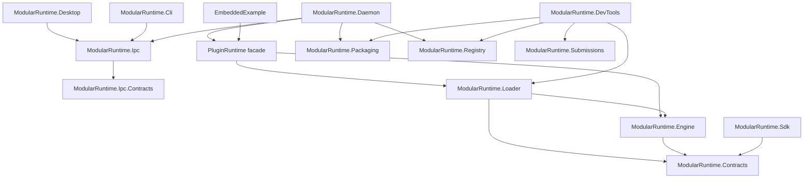

# Architecture

## Goals

ModularRuntime separates plugin contracts, lifecycle management, physical loading, and host
presentation, and provides an in-process communication platform shared by plugins and hosts. The
implementation is designed around these constraints:

- the engine must not know how assemblies are loaded;
- the loader must use one collectible load context per plugin;
- plugin contracts must keep one runtime-wide identity (`ModularRuntime.Contracts`, and the shared
  contract assemblies plugins declare);
- lifecycle operations must be concurrency-safe and failure-isolated;
- the daemon and embedded applications must share the same composition code;
- the runtime lives in one background process per user profile (the daemon) and user interfaces
  are separate IPC clients whose lifetime never affects the runtime;
- plugin deployments must be directory-based and validated before loading;
- plugins communicate only through runtime-mediated contracts (events, JSON/binary/typed
  services, streams, extension points) and never reference each other's assemblies;
- every resource is owned by exactly one host or plugin instance and is released automatically,
  so a stopped plugin's load context can be collected.

Non-goals are in [ROADMAP.md](ROADMAP.md). The communication platform is specified in
[COMMUNICATION.md](COMMUNICATION.md), the process split in [OPERATIONS.md](OPERATIONS.md) and
[IPC_PROTOCOL.md](IPC_PROTOCOL.md).

## Components



| Project | Responsibility | Must not depend on |
|---|---|---|
| `ModularRuntime.Contracts` | Public plugin API: lifecycle, context, events, JSON/binary/typed services, streams, extension points, ownership, payloads, results, logging | Engine, Loader, IPC |
| `ModularRuntime.Engine` | Registration, lifecycle, event bus, service registry (JSON, binary, typed with generated proxies), stream registry, extension registry, resource ownership, concurrency, cancellation, failure isolation, state version | Loader, IPC. It never loads plugins; its only `AssemblyLoadContext` use is placing generated typed-service proxies in the context of the contract assembly and the default shared-type policy |
| `ModularRuntime.Loader` | Discovery, manifest validation, collectible loading, shared contract contexts, composition facade (`PluginRuntime`) | IPC, Daemon |
| `ModularRuntime.Sdk` | Helpers for plugin authors over the contracts (typed JSON, operation routers, stream readers); private to each plugin | Engine, Loader |
| `ModularRuntime.Ipc.Contracts` | Protocol v1: envelope, operation and notification names, error codes, DTOs | Everything (no references) |
| `ModularRuntime.Ipc` | Framing, pipe security, server, client, typed `RuntimeClient`, profiles, daemon launcher | Engine, Loader, Contracts |
| `ModularRuntime.Daemon` | Process that owns `PluginRuntime`; maps IPC operations to runtime APIs; package manager; log store; single instance; shutdown | WPF, clients |
| `ModularRuntime.Cli` / `ModularRuntime.Desktop` | Command-line and WPF IPC clients | Engine, Loader, Contracts |
| `ModularRuntime.Packaging` | Package format, signatures, trust store, verification, installation store, load verifier | Daemon, UI |
| `ModularRuntime.Registry` | Signed catalog client, revocation source, public publication rules | Daemon, UI |
| `ModularRuntime.Submissions` | Public submission format and secret classifier | Runtime |
| `ModularRuntime.DevTools` | `dotnet modularruntime`: validate, pack, inspect, prepare-submission, registry-check, doctor | Daemon, Ipc, Desktop, signing |
| `ModularRuntime.Templates` | `dotnet new` content (no code dependencies) | |

Inside the engine:

```text
PluginEngine (one per runtime, RuntimeId)
 ├─ lifecycle: PluginSlot per plugin (gate, state, instance, lifetime token)
 ├─ RuntimeCore
 │   ├─ EventBus          copy-on-write subscriptions per topic
 │   ├─ ServiceRegistry   one provider per service ID: JSON handler, binary handler, or typed instance
 │   │                    (typed proxies emitted by TypedProxyEmitter, calls through TypedCallContext)
 │   ├─ StreamRegistry    one producer per stream ID, a bounded channel per subscriber
 │   ├─ ExtensionRegistry points + contributions (same invocation engine as JSON services)
 │   ├─ CallbackRegistry callback registrations; shared wrappers emitted by CallbackEmitter
 │   └─ SharedTypes       the shared-value check: SharedTypeAnalyzer (closed/open/private by
 │                        construction, weak-keyed cache), ValueScanPlans (bounded inspection
 │                        of open values), ValueScan (per-thread scan state)
 ├─ OwnershipScope per plugin instance + one host scope
 │   (resources, in-flight invocation counter, cancellation, drain)
 └─ RuntimeScopeFacade: IRuntimeScope / IPluginContext bound to one scope
```

The engine exposes `IPluginInstanceFactory` (`CreateAsync`, `ReleaseAsync`); the loader implements
it with `AssemblyPluginInstanceFactory`. This boundary keeps loading details out of the engine.

## Contracts

One assembly, one namespace (`ModularRuntime.Contracts`), organized in folders: lifecycle
(`IPlugin`, `IPluginContext`, `PluginId`, `PluginDescriptor` with `StartOrder` and
`SharedContracts`, `PluginState`, `PluginApiVersion`); scope (`IRuntimeScope`: owner, events,
services, typed services, streams, extensions, resources); `Events/`, `Services/` (JSON, binary,
typed), `Streams/`, `Extensions/`, `Ownership/`, `Invocation/` (`JsonPayload`, `PluginRequest`/
`PluginResponse`, `BinaryRequest`/`BinaryResponse`, results); results and errors
(`PluginOperationResult`, `PluginErrorCodes`, `PluginRuntimeException`, `TypedServiceException`,
`PluginDiagnostic`); logging.

Only neutral data crosses plugin boundaries through JSON and binary mechanisms: `JsonPayload`
(validated, immutable UTF-8 JSON), bytes, strings, numbers, GUIDs, `Version`, and the records
defined here. Typed services and streams pass objects of **shared types** (contract assemblies,
`ModularRuntime.Contracts`, the framework).

The product version is `0.7.0`; the plugin API is experimental, version `0.4`, and
`ModularRuntime.Contracts` has `AssemblyVersion` `0.4.0.0` ([VERSIONING.md](VERSIONING.md)).

## Engine

`PluginEngine` owns a registry of `PluginSlot` objects: the immutable descriptor, one single-use
factory, a `SemaphoreSlim` gate serializing start/stop for that plugin, the state, timestamps,
instance ID, last error, and a lifetime token source while an instance is attached. Each started
instance gets an `OwnershipScope` and a context whose facades are bound to that scope; the engine
owns one host scope (`PluginEngine.Host`), released last during disposal.

Properties:

- **Automatic cleanup.** Stop, failed start, and disposal close the instance's scope, cancel and
  drain its in-flight handlers and typed calls, run `ShutdownAsync`, release every resource it
  owns, detach the instance, and only then release the factory ([LIFECYCLE.md](LIFECYCLE.md#teardown-order)).
- **Runtime isolation.** Every engine has its own `RuntimeId`, registries, and scopes; no static
  or process-wide registry.
- **No plugin references after shutdown.** Results, retained errors, log entries, load errors,
  descriptors, client handles, and proxies store text and identifiers, never exception objects,
  handlers, or instances. Exceptions are converted to text immediately and dropped before any
  further await.
- **Typed services** never hand out the provider's object: `TypedProxyEmitter` emits one proxy
  type per contract into a collectible dynamic assembly created in the contract assembly's load
  context (so it dies with that context), calling the instance directly through
  `TypedCallContext`, which performs admission, cancellation linking, reentrancy frames
  (thread-local for synchronous calls), exception translation, and the shared-value check.
  `DispatchProxy` is not used because it emits into the base type's context, which is not
  collectible when the engine lives in the default context. Callbacks follow the same design:
  `RegisterCallback` emits a forwarding delegate (a `DynamicMethod` closed over a
  `TypedCallContext`, associated with the delegate type's module so it is collectible with a
  contract) that resolves the registration on every call and holds nothing of the owner.
- **Safety by construction at typed boundaries.** `SharedTypeAnalyzer` classifies every type as
  closed (nothing a value can reference is private: primitives, strings, sealed records of
  closed types, typed arrays), open (`object`, interfaces, non-sealed classes, delegates, types
  with such fields: the instance decides), or private (the policy refuses it or a type it is
  constructed from). Contract signatures are validated at registration; closed values are never
  inspected; open values are inspected by generated plans (field reads, collection entries and
  comparers, delegate targets, exception chains, reflection objects, memory managers) with an
  iterative, bounded scan that fails closed (`value_not_verifiable`). The default is
  `TypedValueCheck.Reject` ([COMMUNICATION.md](COMMUNICATION.md#shared-values)).
- **Streams** run no owner code inside the registry: writes only move items into bounded
  channels, so streams need no drain.
- **Defensive diagnostics, best-effort logging, terminal states, failure isolation, ordered bulk
  operations, idempotent disposal, single-use factories** as described in [LIFECYCLE.md](LIFECYCLE.md).

`PluginLifecycle` contains the formal transition table.

## Loader

Discovery scans only immediate subdirectories of the plugin root that contain `plugin.json`,
sorted ordinal-ignore-case so duplicate-ID behavior is deterministic. The manifest reader is
strict (256 KiB, case-sensitive names, unknown properties rejected, every field validated, entry
assembly path contained in the installation, shared contract names validated and their files
required). Failures are data (`PluginDiscoveryError`), never exceptions for one bad installation.

Each plugin gets one private `PluginLoadContext`: collectible, named
`ModularRuntime.Plugin.<id>.<guid>`, backed by `AssemblyDependencyResolver` for managed and
unmanaged dependencies, always returning the runtime's `ModularRuntime.Contracts` for contract
requests, and returning the shared copy for every assembly the plugin declared in
`sharedContracts`.

**Shared contract contexts** (`SharedContractRegistry`): one collectible `ContractLoadContext` per
(assembly name, major version), loaded from the bytes of the first plugin that needs it after
that plugin's installation was verified (so no plugin file is locked by a shared context),
reference-counted by the factories that acquired it, unloaded when the last one releases it. A
contract may resolve only `ModularRuntime.Contracts`, other shared contracts, and the framework;
its references are checked from metadata before loading (`SharedContractRules`, shared with the
developer tool). The loader supplies the engine's `ISharedTypePolicy`: types from the default
context and from shared contract contexts are shared; types from plugins' private contexts are
not.

`AssemblyPluginInstanceFactory` runs the optional `IPluginLoadVerifier` (the daemon's package
verifier, which keeps the plugin's files open for reading while loaded), acquires the shared
contracts, loads the entry assembly, verifies its contracts reference, finds and instantiates the
entry type, and on release unloads the plugin context and releases the contracts. Unload is
cooperative: the runtime requests it; collection happens when no strong references remain.
`RetiredLoadContextTracker` keeps weak references to retired contexts for `WaitForUnloadAsync`.

`PluginRuntime` composes loader and engine for hosts and the daemon: discovery and registration,
start with registration renewal for stopped or failed plugins, restart, unregistration, unload
waits, `GetSharedContracts()`.

## Daemon and clients

The daemon (`DaemonEntryPoint`, `DaemonHost`, `DaemonRequestHandler`, `LogStore`, `PackageManager`)
owns the `PluginRuntime`, the IPC server, the state notifier (which waits on the engine's
`StateVersion`, coalesces changes, and sends `state.changed`), and the ordered shutdown. It maps
each protocol operation to a public runtime API and validates every payload; it contains no
lifecycle logic of its own. The engine never calls into IPC code; the daemon pulls.

IPC is length-prefixed JSON over a per-user, per-profile named pipe; each connection has one read
loop, one task per request (bounded), and a bounded notification queue, so a slow client cannot
stall the daemon. The CLI opens one connection per command; the desktop app supervises one
connection with reconnection. Neither client references the engine, the loader, or the plugin
contracts, so they cannot host plugins. Objects, delegates, and proxies never cross the pipe:
services, streams, and shared contracts are reported as text DTOs.

The plugin manager (`PackageManager` over `ModularRuntime.Packaging` and `ModularRuntime.Registry`)
runs install, update, remove, verify, and update checks as tracked background operations with a
journal for crash recovery; the `RevocationGate` and `PackageLoadVerifier` form the load gate the
loader calls before every load ([OPERATIONS.md](OPERATIONS.md), [SECURITY.md](SECURITY.md)).

## Developer SDK and publishing

```text
ModularRuntime.Sdk ──▶ Contracts                      (private to each plugin; helpers only)
ModularRuntime.Templates                              (dotnet new content; typed kinds ship a contract subproject)
ModularRuntime.DevTools ──▶ Packaging ──▶ Loader ──▶ Engine ──▶ Contracts
                        ──▶ Registry (registry-check), Submissions (prepare-submission)
```

DevTools reuses the loader's manifest rules and `SharedContractRules`, the Packaging path rules,
`PackageBuilder`, and `PackageVerifier`; it reads assemblies as metadata only and builds through
`dotnet build`; it has no signing capability. The administrator's review, controlled build,
approval, and signing tools live in a separate private repository that depends on this one
([REPOSITORY_ORGANIZATION.md](REPOSITORY_ORGANIZATION.md), [PUBLISHING.md](PUBLISHING.md)).

## Concurrency model

- Lifecycle mutations for one plugin are serialized by that plugin's gate.
- Locks are private and local (engine registry, each slot, each scope, event bus, service,
  stream, and extension registries, each stream); no global lock; no lock is held while another
  is acquired; owner state is read outside registry locks.
- No owner code runs under a runtime lock: handlers, typed methods, cancellation callbacks,
  tracked disposables, and loggers are invoked after locks are released; publication dispatches
  a snapshot; registries copy entries before building descriptors.
- Every invocation is admitted through its owner's scope (in-flight counter, rejected once the
  owner is closing) and the registration's release flag is re-checked after admission.
- Reentrancy is detected through GUID-only frames per asynchronous flow (and a thread-local stack
  for synchronous typed calls): stopping a plugin from its own flow returns
  `reentrant_lifecycle_operation`; disposing the runtime from inside any callback throws it.
- `CancellationTokenSource.Cancel()` is never called while a slot or scope lock is held; token
  sources are disposed exactly once; a scope close waits for cancellation callbacks started on
  another thread; releasing an owned resource is one shared operation.
- After plugin code completes asynchronously, the runtime resumes on a fresh thread-pool stack
  (`ThreadPoolHop`, `ConfigureAwaitOptions.ForceYielding` for typed asynchronous calls) before
  returning to callers.

## Testing strategy

- `Engine.Tests`: fake factories and plugins; registration, transitions, concurrency,
  cancellation, shutdown, event bus, JSON/binary/typed services, streams, extension points,
  ownership (lock discipline, shared release), `JsonPayload`.
- `Loader.Tests`: real staged assemblies; discovery and manifest rejection; private dependency
  resolution; contracts identity; shared contract contexts with generated assemblies (version
  rules, dependency rule, reference counting, unload).
- `Integration.Tests`: real loader, engine, and facade with the sample plugins and fixtures;
  start/stop, failure isolation, independent runtimes, restart, unload tracking,
  `PlatformUnloadTests` and `CommunicationUnloadTests` (typed services, binary services, and
  streams across real load contexts, with collection of plugin and contract contexts), negative
  controls.
- `Ipc.Tests`, `Daemon.Tests` (real processes), `Desktop.Tests` (view models), `Packaging.Tests`,
  `Registry.Tests`, `Sdk.Tests`, `DevTools.Tests`, `Template.Tests` (the packed SDK used outside
  the repository against the real daemon and an embedded host, scenarios A–I).
- `benchmarks/ModularRuntime.Benchmarks`: BenchmarkDotNet, separate from the tests
  ([BENCHMARKS.md](BENCHMARKS.md)).

All file-based tests use isolated temporary directories; build targets copy plugin outputs into
the test output directory and tests copy them into their own workspace.

## Design decisions and trade-offs

| Decision | Reason | Trade-off |
|---|---|---|
| Separate contracts assembly | Stable identity across plugin contexts | Breaking changes require coordinated versioning |
| Engine/factory boundary | Keeps ALC details out of lifecycle code | One more abstraction to implement |
| Collectible ALC per plugin | Dependency isolation and cooperative unload | Collection is not deterministic |
| Strict manifest | Early, actionable validation | No forward-compatible unknown fields |
| Terminal stopped/failed states | Avoid accidental reuse of dirty instances | Restart needs a new registration (done by `PluginRuntime`) |
| `PluginRuntime` facade | One composition used by host and embedders | Hides lower-level composition from simple consumers |
| Text-only diagnostics everywhere | Avoid keeping plugin exceptions and load contexts alive | Hosts cannot inspect or rethrow the original exception object |
| JSON text payloads as the universal mechanism | No shared types, no retention, no arbitrary deserialization, interoperable | Callers parse payloads explicitly; serialization cost |
| Typed services through a shared contract assembly and emitted proxies | Direct calls with one type identity, without loading plugin code into the default context; proxies keep provider objects out of consumers | Contracts must be declared and versioned; a contract from a plugin executes in every plugin that shares it |
| Shared-value check (`TypedValueCheck`, `Reject` by default) | Private objects cannot cross typed boundaries, even hidden in shared objects; registration validates signatures | One weak-table lookup per open argument or result; a bounded inspection for values whose type does not settle the question; `Warn`/`None` to opt out |
| Callback registrations instead of raw delegates | A consumer's callback holds nothing of the consumer once released; no reference cycles between plugins | Plugins call `RegisterCallback` instead of passing lambdas |
| Binary payloads borrowed in, transferred out | Zero-copy where it is safe; pooled responses possible | The caller must dispose results; the handler must copy what it keeps |
| Streams on bounded channels with explicit policies | Backpressure or loss is the subscriber's choice; no unbounded queues | Fan-out shares items, so items must be immutable (binary items copied by default) |
| One invocation engine for JSON services and contributions | One set of semantics | Contributions are request/response only |
| Sequential, ordered event dispatch | Predictable order and simple failure isolation | A slow subscriber delays the publisher (use a stream) |
| Scope-based ownership with drain-before-shutdown | Plugins need no cleanup code; `ShutdownAsync` never races its own handlers | Stop waits up to the drain timeout for non-cooperative handlers |
| Reject reentrant stop/dispose | Prevents self-waiting deadlocks | Conservative: background work started from a handler is part of its flow |
| Experimental 0.x API | The project is unreleased; no compatibility layers | Plugins must be rebuilt for every 0.x minor |

## Extension points of the architecture

- Implement `IPluginInstanceFactory` to load plugins by another mechanism; supply an
  `ISharedTypePolicy` that matches it.
- Declare extension points, provide services (of any kind), and create streams from the host
  (`PluginRuntime.Host`).
- Use `PluginEngine` directly when an application owns discovery and loading, or `PluginLoader`
  when it needs candidates with a custom composition.
- Replace `IRuntimeLogger` with an application-specific logging adapter.
- Add host front ends over `PluginRuntime` without touching engine or loader.
