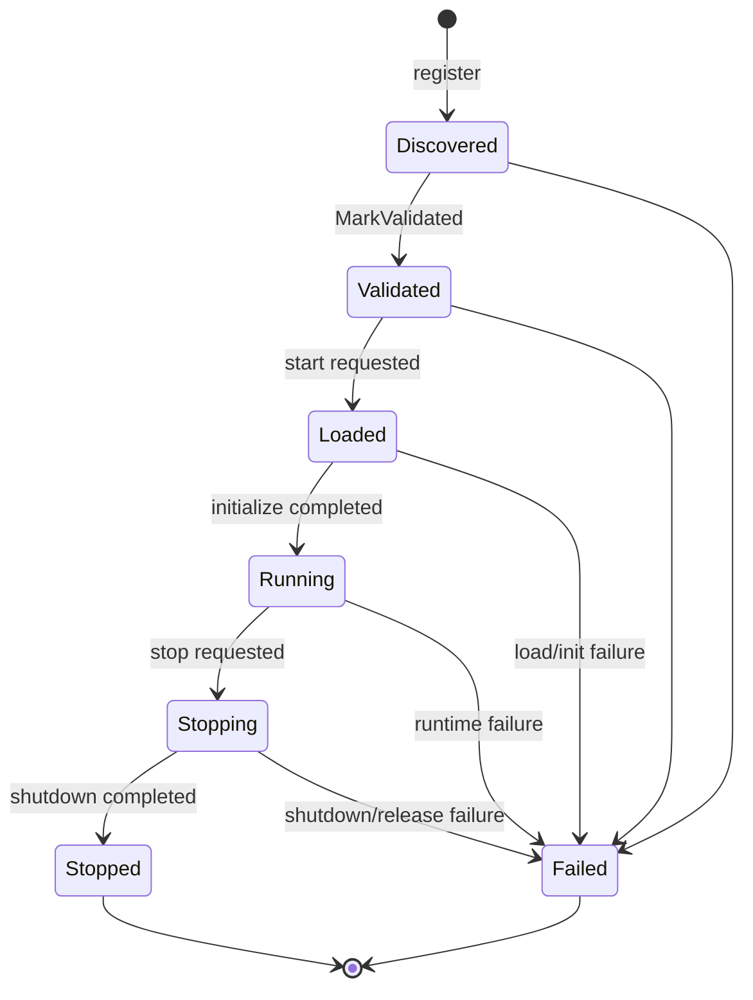

# Lifecycle

## State machine

ModularRuntime uses a formal, per-registration lifecycle. `Stopped` and `Failed`
are terminal for a registration: a new start requires a new registration and a new
load context. `PluginRuntime` creates that registration automatically when a stopped
or failed plugin is started or restarted (see [Restart](#restart)).

`PluginLifecycle.CanTransition` is the authoritative transition table. State
changes in a `PluginSlot` are serialized, and a failed transition is rejected
rather than forced.

| State | Meaning | Can start? | Can stop? |
| --- | --- | --- | --- |
| `Discovered` | Descriptor and factory registered, not validated | no | no |
| `Validated` | Manifest, paths, and API checked | yes | no |
| `Loaded` | Instance created; initialization in progress | no | no |
| `Running` | Initialization completed; instance active | no | yes |
| `Stopping` | Shutdown in progress | no | no |
| `Stopped` | Shutdown completed | no | no |
| `Failed` | Load, initialization, shutdown, or release failed | no | no |

## Registration and discovery

`PluginEngine.Register` accepts a descriptor and a factory. The initial state is
`Discovered`. Duplicate IDs, incompatible API versions, and registration after
shutdown are rejected.

`PluginRuntime.DiscoverAsync` composes discovery and registration:

1. the loader scans the root and validates candidates;
2. one factory is created per candidate;
3. the engine registers the descriptor;
4. the engine marks the plugin `Validated`;
5. if either step fails, the factory is released and the failure is returned.

Discovery and registration failures are data, not process-wide exceptions. One
bad installation does not prevent valid installations from being registered.

## Start

`StartAsync` behavior:

1. Reject immediately if the engine is shutting down or the plugin is unknown.
2. Reject with `operation_canceled` if the caller's token is already canceled.
3. Wait for the plugin gate. Cancellation while waiting returns `Canceled`
   without a state change.
4. Reject with `invalid_state` unless the state is still `Validated`.
5. Transition `Validated -> Loaded`.
6. Ask the factory to create the instance.
7. Attach the instance, create its lifetime token source, its ownership scope,
   and its context (logger, stopping token, events, services, extensions,
   resources).
8. Call `InitializeAsync`. Resources the plugin creates are active immediately
   (other plugins may call a service registered during initialization).
9. On success, transition `Loaded -> Running` and return `Succeeded`.

If loading or initialization fails:

- the state becomes `Failed`;
- if an instance was attached, the runtime performs the full teardown (see
  [Teardown order](#teardown-order)) with a best-effort rollback `ShutdownAsync`
  (`CancellationToken.None`): every subscription, service, extension point,
  contribution, and tracked object created before the failure is released;
- the factory is released;
- the result status is `Failed`, or `Canceled` when the failure was an
  `OperationCanceledException` and either the caller's token was canceled or
  the engine is shutting down (code `operation_canceled` in both cases);
- the result and `LastError` carry a text-only `PluginDiagnostic`.

A cancellation observed during start is therefore terminal for that instance.
This avoids keeping a partially initialized plugin alive.

## Running

While `Running`, the plugin has:

- a unique `InstanceId`;
- an `IPluginContext` with a scoped logger;
- a `StoppingToken` that is canceled when shutdown begins;
- an ownership scope; `PluginEngine.GetResources(id)` / `PluginRuntime.GetResources(id)`
  list the resources it owns;
- timestamps exposed through `PluginRuntimeInfo`.

The engine itself never restarts an instance; suspend, resume, and hot reload are not
provided. Restart is implemented by `PluginRuntime` (below).

## Stop

`StopAsync` behavior:

1. Reject immediately if the plugin is unknown.
2. Reject with `operation_canceled` if the caller's token is already canceled.
3. Reject with `reentrant_lifecycle_operation` if the stop is requested from code
   running on behalf of the same plugin instance (its handlers, lifecycle
   methods, or a callback chain they started); waiting would deadlock.
4. Wait for the plugin gate. Cancellation while waiting returns `Canceled`
   without a state change.
5. Reject with `invalid_state` unless the state is `Running`.
6. Transition `Running -> Stopping` and run the [teardown](#teardown-order).
7. Transition `Stopping -> Stopped` on success.

## Teardown order

Used by stop, by a failed start (rollback), and by disposal:

1. **Close the ownership scope**: no new resources (`scope_closed`), no new
   incoming invocations (services of every kind report `service_unavailable`,
   typed proxies throw it, subscriptions are skipped), in-flight handler and
   typed-call tokens are canceled. Outgoing calls by the plugin (publish, invoke,
   stream writes) remain allowed until step 5.
2. **Cancel `StoppingToken`.** Callbacks run outside every lock; failures are
   logged as `cancellation_callback_failed`.
3. **Drain** in-flight handlers, bounded by `RuntimeLimits.DrainTimeout`
   (default 10 s). On timeout a `drain_timeout` warning is logged and teardown
   continues; such handlers keep running in-process.
4. **`ShutdownAsync`** (rollback shutdown after a failed start).
5. **Release owned resources** in reverse registration order, waiting for
   releases already started by the plugin itself; registries drop handler
   references and typed instances; streams owned by the plugin complete their
   subscribers with `stream_removed`; its stream subscriptions are detached;
   extension points owned by the plugin are removed with all their contributions.
6. **Detach** the instance and dispose its lifetime token source; resume on a
   fresh thread-pool stack so callers never continue on top of plugin frames.
7. **Release the factory**, requesting unload of the load context and releasing
   the plugin's leases on shared contract contexts (a contract context is unloaded
   when its last user releases it).

Failure handling:

- If `ShutdownAsync` throws, the state becomes `Failed` and the result is
  `Failed` (or `Canceled` when it threw `OperationCanceledException` and the
  caller's token was canceled). Resources are still released.
- If releasing a tracked resource throws, the remaining resources are still
  released and the state becomes `Failed` with `resource_cleanup_failed`.
- If factory release fails after shutdown succeeded, the state becomes `Failed`
  with `release_failed`.
- Shutdown is still attempted for a plugin whose factory release later fails.

A stopped plugin keeps its last instance ID and timestamps for diagnostics, but
the engine has already detached the instance and released the factory.

## Restart

`PluginRuntime.StartAsync` on a `Stopped` or `Failed` plugin renews its registration
instead of being rejected, and `PluginRuntime.RestartAsync` is a stop (if running)
followed by that start:

1. A per-plugin gate serializes renewal; the state is re-checked inside it, so
   concurrent starts create exactly one new instance.
2. The installation is read and validated again (manifest, entry assembly, API
   version). If it is no longer valid the start fails with `factory_failed` and the
   stopped registration is kept for diagnostics.
3. The old registration is unregistered (its load context was already asked to
   unload; only a weak reference is kept for `WaitForUnloadAsync`).
4. A new factory is registered. On load it creates a new `AssemblyLoadContext`, after
   the `IPluginLoadVerifier` checked the package signature and every file's SHA-256
   for managed packages; a modified installation is never loaded.
5. The engine starts the new registration: new instance ID, context, and ownership scope.

Nothing from the previous instance (load context, factory, instance, context, scope) is
reused. `StartAllAsync` restarts stopped plugins but does not retry failed ones; those
are retried by an explicit start. The `PluginEngine` used directly (embedded without
`PluginRuntime`) keeps the terminal rule: register again to start again.

## Bulk operations

`StartAllAsync` visits plugins in ascending `PluginDescriptor.StartOrder`
(manifest `startOrder`, default 0), keeping registration order for ties.
`StopAllAsync` visits them in the reverse order. Bulk operations continue after individual
failures: each result is collected and returned.

A plugin that fails initialization does not prevent later plugins from starting.
A plugin that fails shutdown does not prevent earlier plugins from stopping.

Disposal uses the same reverse-order stop attempt, then releases every factory,
including factories for plugins that never started.

## Dispose

`PluginEngine.DisposeAsync` and `PluginRuntime.DisposeAsync`:

- set the engine shutdown flag;
- reject new registrations and starts;
- cancel the lifetime (and therefore the initialization token) of instances that
  are still initializing, so a cooperative plugin aborts initialization instead
  of blocking shutdown; the start returns `Canceled` / `operation_canceled` and
  the instance is rolled back and marked `Failed`;
- stop running plugins in reverse start order (full teardown for each);
- release all remaining factories;
- close the **host** scope last (drain host handlers, release host
  subscriptions, services, extension points, contributions, tracked objects), so
  host subscribers and host extension points stay usable while plugins shut down;
- complete idempotently: subsequent calls await the same shutdown task;
- throw `PluginRuntimeException` (`reentrant_lifecycle_operation`) when called
  from inside one of the runtime's own callbacks.

Individual stop failures are logged and do not throw out of disposal. Expected
`invalid_state` results for already stopped, failed, or never-started plugins are
not treated as errors during disposal.

Disposal does **not** guarantee immediate garbage collection of plugin load
contexts. It requests unload; collection is cooperative and happens once no
strong references remain.

## Unload tracking

`PluginRuntime` remembers every load context a plugin leaves behind (unregistration and the
previous runs of a restarted plugin) through **weak references only**, until each one is observed
collected:

- `GetPendingUnloadCount(id)` returns how many retired contexts of the plugin are still alive.
- `WaitForUnloadAsync(id, timeout)` (`PluginUnloadWait.Observe`) only observes. The runtime never
  forces a garbage collection on its own.
- `WaitForUnloadAsync(id, timeout, PluginUnloadWait.InduceCollection)` also induces collections.
  It is used only for explicit maintenance that needs the plugin's files released (the daemon's
  update and removal) and for diagnostics. It first flushes the System.Text.Json reflection caches,
  which live in the shared context and otherwise keep plugin types reachable until their lazy
  eviction (the next serialization).
- A wait that **times out** returns `false`, and one that is **canceled** throws
  `OperationCanceledException`. In both cases every live context stays tracked, so the wait can be
  repeated. Unload is never reported complete while a context is alive.
- Records of collected contexts are pruned whenever a context is tracked or queried, so many
  start/stop cycles do not accumulate them. All members are thread-safe and hold no lock while
  waiting.

Plugins that are restarted often in hosts that do not use System.Text.Json themselves can avoid
the serializer caches entirely with a source-generated `JsonSerializerContext`.

Shared contract contexts are not part of a plugin's retired contexts: they are reference-counted
by the plugins that declare them and unloaded when the last one is released
(`PluginRuntime.GetSharedContracts()` lists the live ones). Typed-service proxies live in the
contract's context and are collected with it; a proxy kept by a consumer holds only identifiers
and does not keep a stopped provider alive. A callback registered with `RegisterCallback` is
released with its owner: the wrapper another plugin holds then answers `callback_released` and
retains nothing. Raw delegates and objects a consumer hands to a provider are refused by default
(`TypedValueCheck.Reject`); in `Warn` mode they cross and keep the consumer alive until the
provider drops them.

## In the daemon (v0.3)

`ModularRuntime.Daemon` drives exactly this lifecycle through `PluginRuntime`;
IPC requests map one to one onto `StartAsync`, `StopAsync`, `StartAllAsync`, and
`StopAllAsync`, and the results travel back unchanged (`OperationResultDto`).

- Every state transition, registration, and ownership change increments the
  engine's `StateVersion`; clients receive `state.changed` and reload snapshots.
  Clients never change displayed state before the daemon answers.
- Lifecycle requests that arrive while the daemon is stopping are rejected with
  `daemon_stopping`.
- Daemon shutdown is `PluginRuntime.DisposeAsync` (above), bounded by the
  daemon's shutdown timeout (default 30 s). If a plugin ignores cancellation and
  the bound expires, the daemon logs it and exits with code 3; whatever that
  plugin was still doing ends with the process.
- A client disconnecting, crashing, or closing its window has no effect on
  plugin state.

See [OPERATIONS.md](OPERATIONS.md).

## Concurrency

- One gate per plugin serializes start, stop, and disposal operations for that
  plugin.
- Different plugins can be started or stopped concurrently by separate callers,
  although `StartAllAsync`/`StopAllAsync` themselves process sequentially.
- Concurrent operations on the same plugin may observe `invalid_state` once the
  first operation wins.
- The engine registry is locked during mutation; snapshots are returned for
  enumeration.
- The shutdown flag is checked before and after gate acquisition to reject work
  that races with disposal.

## Failure isolation

A plugin failure is represented by:

- `PluginOperationResult` for the operation that failed;
- `PluginRuntimeInfo.LastError` with a code, operation, message, exception type,
  diagnostic text, and timestamp;
- log entries produced by the engine and loader.

The engine retains error strings, not exception objects. Full exception details
(type, message, stack trace, `ToString()` text) are available as a text-only
`PluginDiagnostic` in the immediate result, in `LastError`, and in log entries,
so a host may keep all of them without preventing the plugin's load context from
being collected. All plugins still share one
process, so a plugin that terminates the process, corrupts shared state, or
blocks a thread cannot be contained by the lifecycle engine. See
[SECURITY.md](SECURITY.md).
